So I was biking into work on my birthday when I saw a **Really Nice Stick** hidden in the leaves in the side of the road.

"That's a suspiciously good looking stick." I thought to myself as I passed it, pulling up to a stop a few meters beyond it.

I went back, picked it up and yep, it was too good to be just a stick.
This particular stick was indeed a sword, and upon unsheathing it and revealing the absolutely rusted blade, one that was not particularly well taken care of.

This being the route to school, and only a few hundred feed from home, I took it back and chucked it in the trash.

But it stuck in my mind for the day.

## Exploration

> Okay, so today's my birthday yay! Anyway, I was biking on today and I see this really nice stick, and I'm like, "is that...? No way" so turn around and sure enough it is a katana just sitting in the gutter. The blades rusted to hell, and the wrap on the handle is gone and the pommel is missing, bit it seats very nicely in the scabbard. So I know its a bad idea, this was likely a display piece before and will only ever be a display piece again, but I kinda want to restore it. So what a involved in restoring something like this? How do I properly assess the damage and what can or cannot be restored? Where should I start once I get going? What tools and materials do I need? Please provide some references for a project like this. Thanks!

> Nice find. Before anything else, you need to figure out what it is, because that decides whether you should touch the blade at all.
> 
> The key question: replica or real?

Thanks for getting my hopes up Claude.

It was definitely a show piece, see the photo below.
The biggest, easiest tell, even before taking it apart (I didn't get a photo of it before disassembly, unfortunately) is that the hilt is secured with a nut.
The tang, of course, is also not a full tang, so you don't really want to go whipping this thing around, as the blade could snap off at the joint.
A quality sword would have a full width tang with a hole in it that would secure it to the grip with bamboo peg.

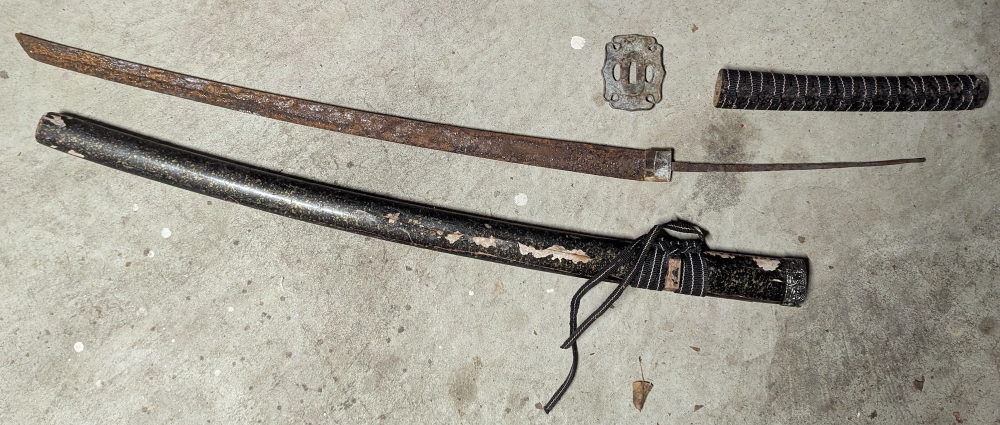

The first suggestion was to use some rust-off liquid or gel and some steel wool to try to scrape it off.

Yeah, that was awful.

It stuff smelled atrocious and didn't do a really good job of it either.
So the next step was to do some electrolysis.

## Electrolysis

In electrolysis, you connect the metal you want to remove rust from to the cathode, connect the anode to a sacrificial steel rod and apply a current through solution to force the rust off the cathode.
I picked up a cheap 12V battery recharger and dumped in a bunch of baking soda (not the best as we'll see below) into a flat basin of water and hooked it up with a garden stake as the anode.

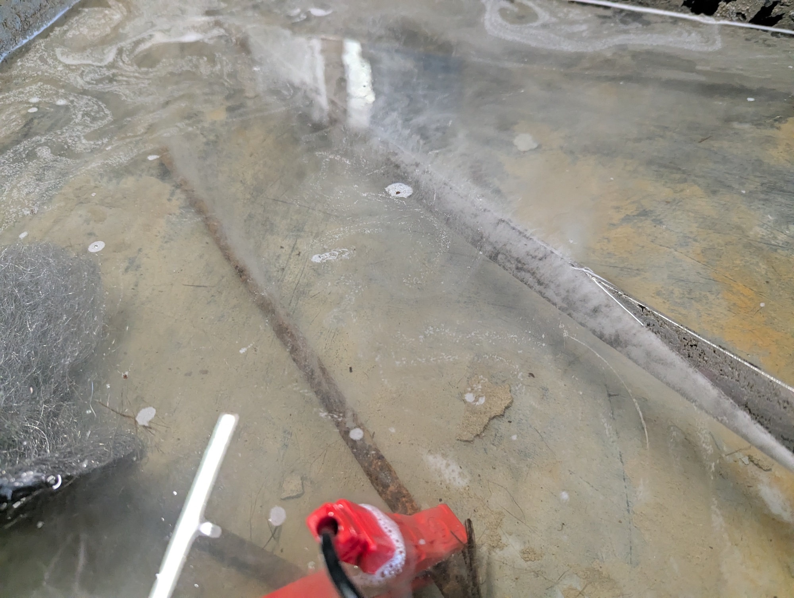

One thing to note in that photo: Be advised that whatever part of the anode is in solution will rust.
So if you leave the clip that connects your charger to the sacrificial steel, the clip will also rust.
In hindsight this was obvious, but in my rush to try it out, I just clipped it on and dunked it in.

It actually came out looking pretty good in a couple of hours:

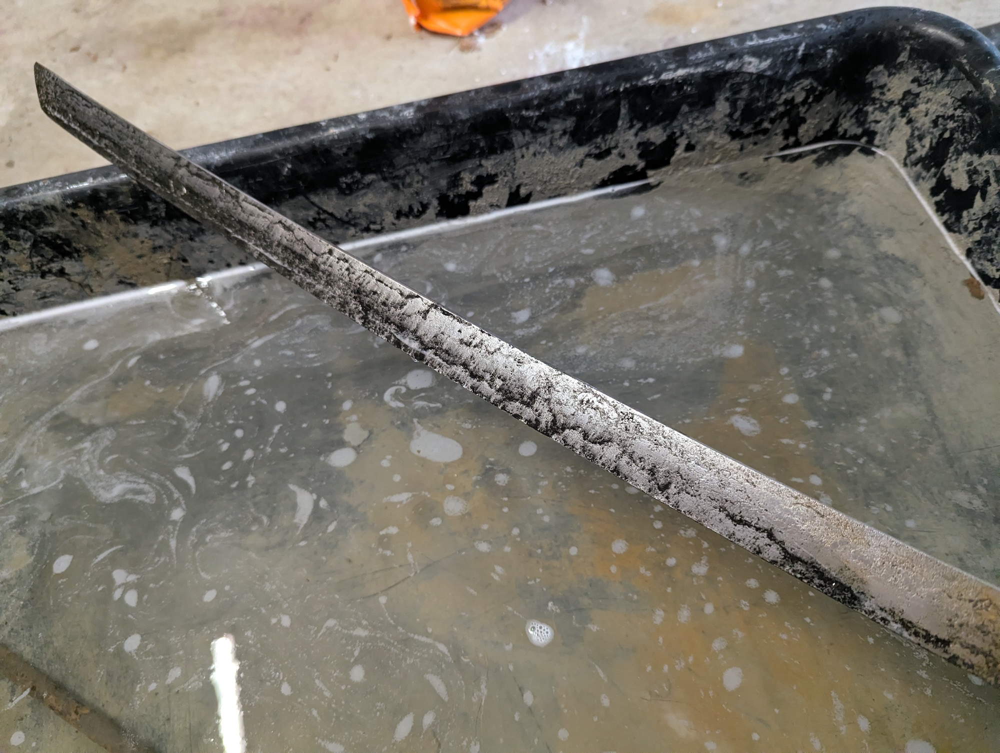

A few repeated baths and running the towel and steel wool over it in between cycles and the blade actually looked as good as it was going to get.

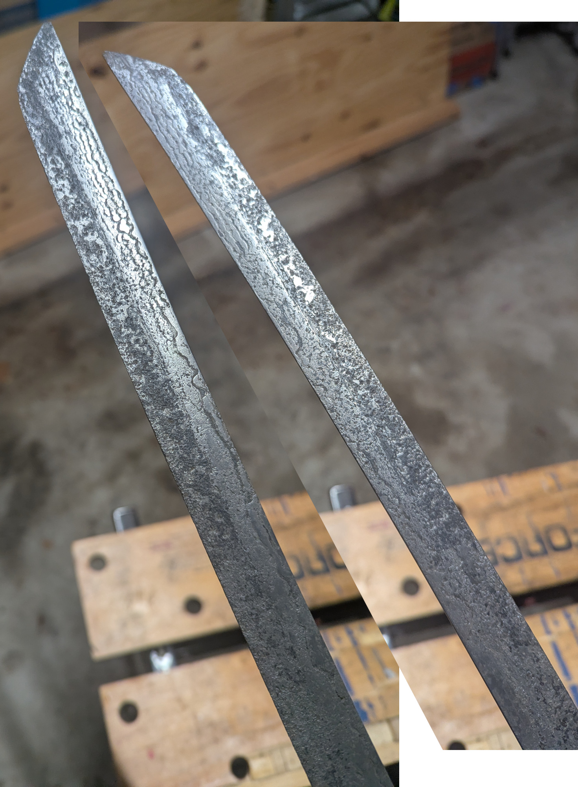

Of course, I didn't know this at the time.

## Electrolysis Round 2

One downside to the above setup was getting the entire blade in the solution.
Since it was a shallow bin not quite wide enough for the entire blade, it was propped up on one end and there was a pretty sharp line between the rust-free and the rusted regions.

So round 2 was building this PVC contraption:

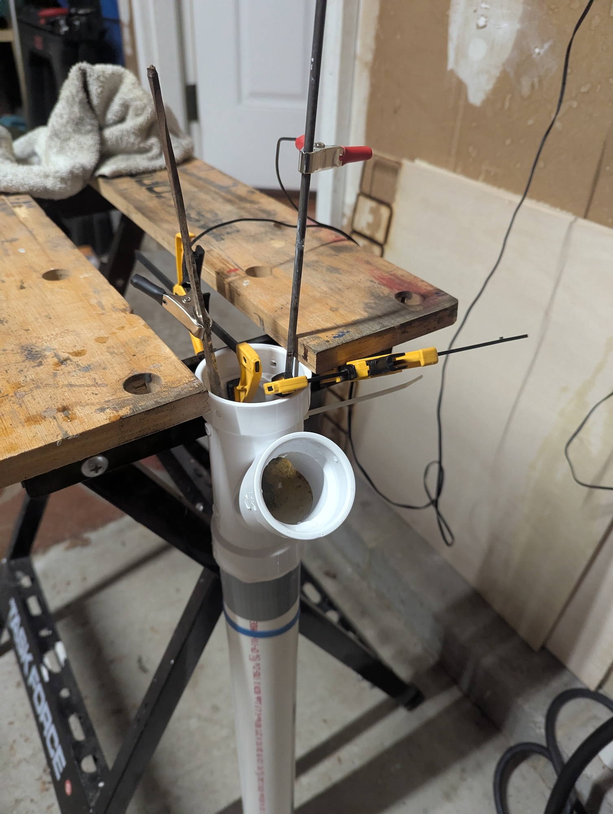

The Y-tube at the top was there to pull the water level above the blade and onto the tang a bit.
It actually ended up being somewhat useful when pouring water out.

The right clamp secured the anode and kept it from slipping all the way to the bottom and touching the sword tip.
The sword was then fully submerged and could be flipped to expose the other side to the anode.
It doesn't really matter since it's all in solution, but it could make it go a bit faster.

Additionally, the 12V battery charger wasn't working in this situation, for some reason it was no longer seeing the circuit as something that needed to be charged.
So I ended up getting some clips and soldering them to a 12V power brick I had laying around.
This "dumb charger" worked significantly better than the 12V battery charger and I would highly recommend it over the charger.

At this point the blade was looking really good:

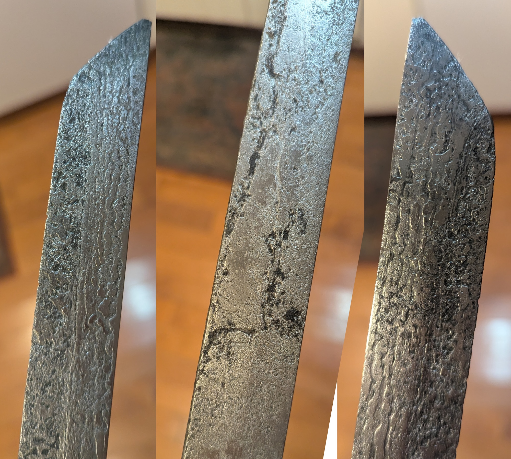

A couple of notes, the anode will keep corroding, so you'll keep getting rust-colored stuff at the top of the solution, even if you're done.
The black stuff in the pits is black oxide (magnetite) which is stable and won't come out.

## Building the Hilt

At this point I moved onto building the hilt.
I rigged up a pair of pine furring strips to see how easy that would be to shape and used the belt sander at the local makerspace to start shaping it.
The pine shaped really easily, but the belt sander was not the correct tool for it.
It would only really take the edges off, but wasn't going to follow any other curves.
But doing this convinced me that I could do some reasonable shaping with my random orbit sander and some low-grit sandpaper.

Next up, then, I cut some blanks out of some oak I had laying around, adding as much to the shaping as I could.
I left a bit of extra at the front and back that I ran a screw through to keep it together.
Between the sander, 40-grit sandpaper, and an hour I had the majority of the shaping down - the edges were rounded off into a reasonable approximation of an oval, and the other rough spots were all aligned between the two halves.

I then split them apart, removed the excess wood from the top, and then started cutting a channel for the tang using my router attachment on the Dremel.
Despite working in oak, it went pretty fast once I got the hang of it.
I cut a matching channel in the other side, and then prepped them for gluing together - sanding down the top so each side was level again.

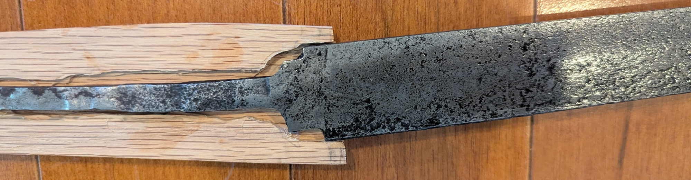

One thing this test fit really highlighted was the steep angle between the blade and the hilt.
You can really see this when it's all together, it just looks wrong:

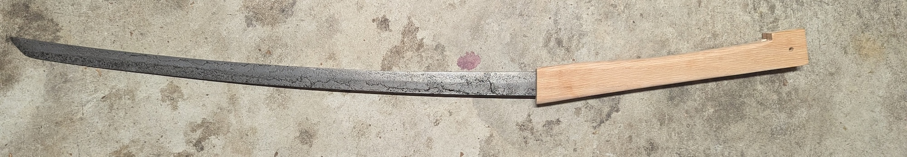

This wasn't going to work, so I spent some time bending the tang into a better position given the channel.

At this point, I mixed up a full tube of Gorilla Glue epoxy, coated both sides of the channel with a thin layer on the surrounding wood for good measure, clamped it shut and waited for the cure.
Once it was cured, I knocked off the back bit, sanded it down again, and got to what looks like a better angle:

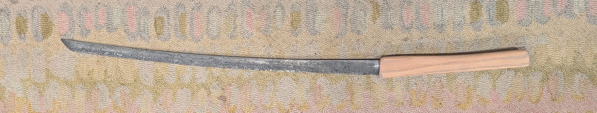

## Finishing

I ordered some Ito wrap and learned how to do the wrapping.
Once you get into the pattern it's quite straightforward, with two key points:
- first make sure that you're applying quite a bit of tension, any loose slack is going to translate into movement, especially on the bare wood of the hilt
- second make sure the twist ends before the turn of the handle, that way you can keep the diamond centered on the grip

I didn't have the traditional closure at the pommel, and so I just tied it off.

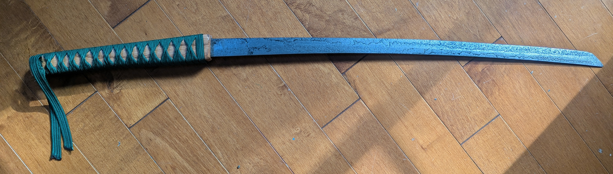

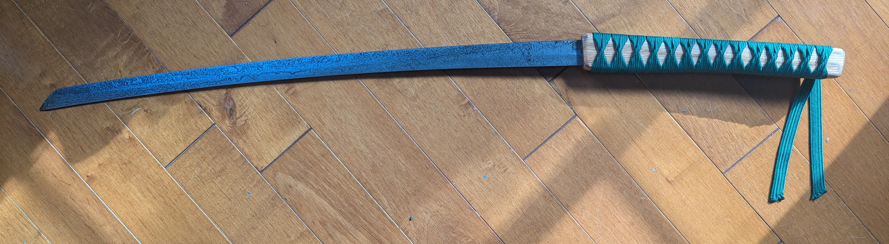

## Display

The sword is honestly pretty awful, it's dull, has an awful tang, and has a ton of pitting from all the rust.
Still I think it looks pretty neat, it's a great conversation piece and I like being reminded of a project well done, so I wanted to put it up for display.

After initially thinking of a more standard mount, I came up with the idea for a Tori gate wall mount.
This was far beyond my CAD modelling experience (which is limited to doing pretty cool stuff in [TinkerCAD](https://www.tinkercad.com/)), but I recently heard about [solidcraft](https://solidcraft.io/) which has a native MCP binding for agents.

I hadn't yet used any MCP servers, so I figured this would be a good first attempt.
I went back and forth a bit with Claude Opus 5.5 on the design, in particular were the printer bed size (since this limited the gate size) as well as the sword dimensions and center of mass.

The holder design it came up with was pretty good and included a nice locking dovetail that would prevent the hooks from falling out when mounted to the wall, along with some caps for the screw-holes so it could be screwed in from the front with wall anchors.

Claude, nearly got it right the first time.

The hooks were a bit too large to rotate in through the back - I took a demonstration photo, but instead Claude was able to verify the collision using the MCP.
Armed with this new information a second hook design was constructed, the insertion simulated in SolidCraft, reprinted and it's working great:

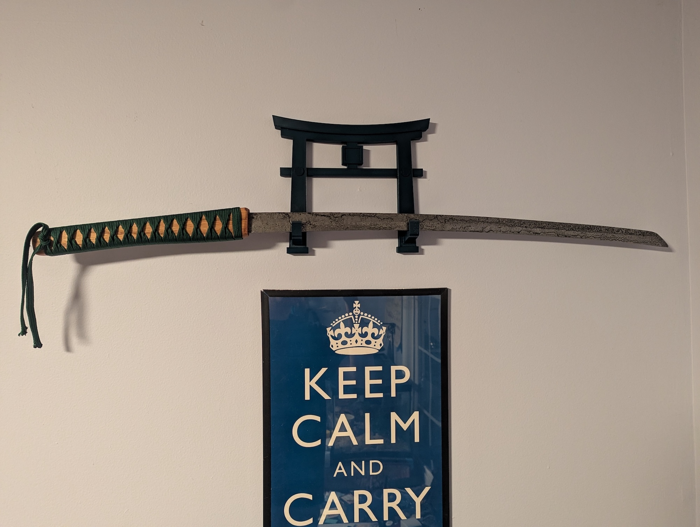

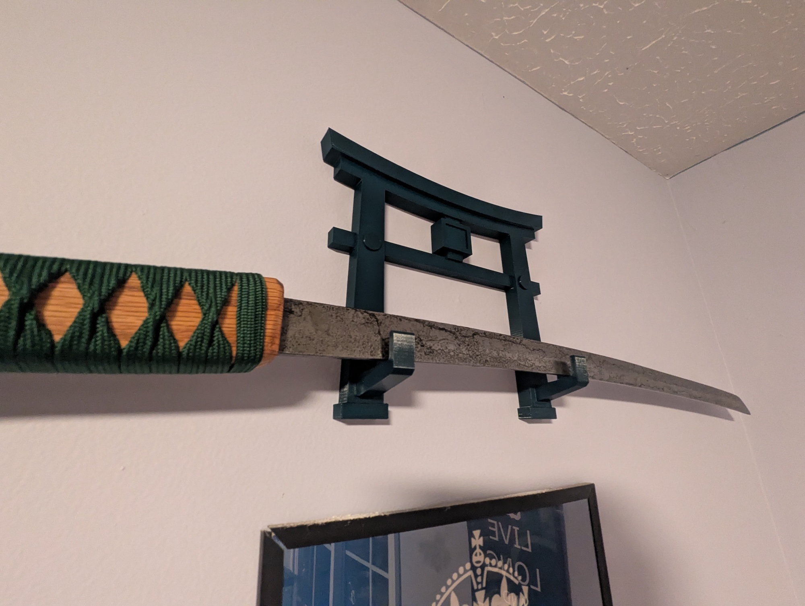

## Bonus: Usage

Look, I finished it Halloween weekend, we had a pumpking that was just going to rot, of course I had to slice it up.

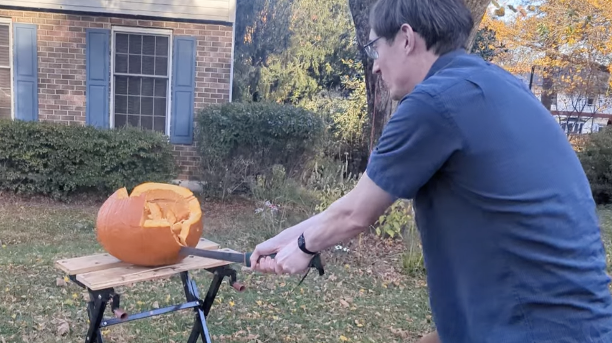

As expected it was pretty awful as a real sword.
It wasn't sharp, the wrap came off while we were using it, but, hey it was good enough to eliminate a pumpkin, and it still looks great up on the wall!
